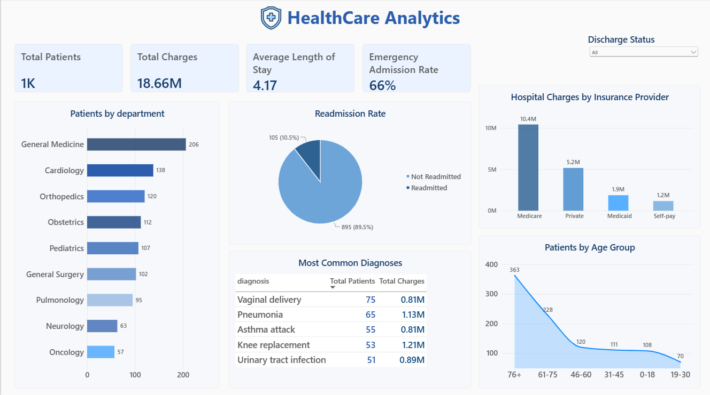

# 🏥 Healthcare Analysis Dashboard 

## 📌 Short Description

An interactive dashboard designed to analyze healthcare data, providing insights into patient demographics, hospital admissions, readmissions, and financial performance.

## 🎯 Project Purpose

To explore healthcare data and identify meaningful patterns in patient distribution, hospital operations, and healthcare expenses through interactive visualizations.

## 📊 Key Metrics & Visualizations

- **Total Patients** – Overall patient count.
- **Total Hospital Charges** – Total hospital charges.
- **Average Length of Stay** – Average patient stay duration.
- **Emergency Admission Rate** – Percentage of emergency admissions.
- **Patients by Department** – Patient distribution across departments.
- **Readmission Rate** – Percentage of readmitted patients.
- **Patients by Age Group** – Patient distribution by age.
- **Insurance Coverage** – Hospital bills covered by insurance.
- **Top 5 Diagnoses** – Diagnosis-wise patient count and hospital charges.

## ✨ Features / Highlights

- Monitor patient volume, hospital charges, and length of stay to assess hospital activity.
- Identify departments with higher patient volumes and analyze emergency admission patterns.
- Track readmission rates to explore patient return trends.
- Examine age-group distribution to understand patient demographics.
- Analyze insurance coverage and identify diagnoses contributing most to patient volume and hospital expenses.
- Use the interactive Discharge Status slicer to explore and compare patient groups.

## 🛠️ Tech Stack

- **Power BI** – Dashboard development and data visualization.
- **Power Query** – Data cleaning and transformation.
- **DAX** – Calculated measures and KPI development.

## 📸 Dashboard Preview

Show what the dashboard looks like. - 
**Example:** [View Dashboard Screenshot](https://github.com/Arsheana-Chowdhury/Healthcare-Analytics/blob/main/Dashboard%20Preview.png)
